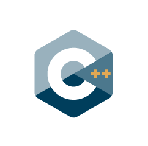

<!-- ======= Section ======= -->
  <section id="code" class="feature">
    

      <h1 class="page_title">Les codes proposés</h1>
  

        <!-- ++++++ Code feature ++++++ -->
        

          

            

              

              

                  <h1>
                      josiepy
                  </h1>
                  <h2>
                      Méthodes volumes finis en Python
                  </h2>
              

              

                  
              

                

                  <a href="https://gitlab.com/rubendibattista/josiepy" class="github"><i class="bx bxl-github"></i></a>
                  <a href="https://josiepy.rdb.is" class="readdoc"><i class="bx bx-file"></i></a>
                

              

            

            

              <h3>josiepy</h3>
              
Josiepy est une librairie en Python qui permet de mettre en place des simulations pour des problèmes qui sont gouvernés par des EDP avec simplicité avec la méthode des volumes finis. Tous les aspects d'un problème sont codé directement en Python, en évitant les difficultés que très souvent on rencontre dans des autres codes dans lesquels les configurations se font avec des DSL très limités

            

            
 <a href="josiepy.html">
              
En savoir +<i class="point"></i><i class="point"></i><i class="point"></i>

              </a> 

          

        

        <!-- ++++++ Code feature ++++++ -->
        

          

            

              

              

                  <h1>
                      mercurve
                  </h1>
                  <h2>
                      Outils de post-traitement
                  </h2>
              

              

                  
              

                

                  <a href="https://gitlab.com/rubendibattista/mercurve" class="github"><i class="bx bxl-github"></i></a>
                  <a href="https://docs.mercurve.rdb.is" class="readdoc"><i class="bx bx-file"></i></a>
                

              

            

            

              <h3>mercurve</h3>
              
Mercurve est une librairie en C++ qui permet d'effectuer le post-traitement de simulations DNS diphasiques. Mercurve effectue une triangulation de l'interface entre les deux phases de l'écoulement, il calcule des propriétés géométriques comme la courbure moyenne et la courbure de Gauss avec une approche qui préserve certains invariants topologiques, en donnant la possibilité d'obtenir plus d'information à travers ces simulations qui sont après utilisées pour le développement de modèles réduits. 

            

            
 <a href="mercurve.html">
              
En savoir +<i class="point"></i><i class="point"></i><i class="point"></i>

              </a> 

          

        

        <!-- ++++++ Code feature ++++++ -->
        

          

            

              

              

                  <h1>
                      pylbm
                  </h1>
                  <h2>
                      Lattice Boltzmann methods
                  </h2>
              

              

                  
              

                

                  <a href="https://github.com/pylbm/pylbm" class="github"><i class="bx bxl-github"></i></a>
                  <a href="https://pylbm.readthedocs.io/" class="readdoc"><i class="bx bx-file"></i></a>
                

              

            

            

              <h3>pylbm</h3>
              
Pylbm est un logiciel open source écrit en Python. Il propose une implémentation flexible de la méthode Lattice Boltzmann pour les problèmes 1D/2D/3D et a été créé pour s'adresser à diverses communautés : mathématiciens,  physiciens  et informaticiens. La principale caractéristique de pylbm est sa grande flexibilité en termes de schémas LBM et d'implémentations de code numérique. De plus, il possède d'excellentes capacités parallèles et utilise MPI pour le calcul distribué et openCL pour les GPU.

            

            
 <a href="pylbm.html">
              
En savoir +<i class="point"></i><i class="point"></i><i class="point"></i>

              </a> 

          

        

        <!-- ++++++ Code feature ++++++ -->
        

          

            

              

              

                  <h1>
                      samurai
                  </h1>
                  <h2>
                      Adaptation de maillage
                  </h2>
              

              

                  
              

                

                  <a href="https://github.com/hpc-maths/samurai" class="github"><i class="bx bxl-github"></i></a>
                  <a href="https://hpc-math-samurai.readthedocs.io" class="readdoc"><i class="bx bx-file"></i></a>
                

              

            

            

              <h3>samurai</h3>
              
L'objectif principal de Samurai est de fournir une nouvelle structure de données basée sur les intervalles et l'algèbre d'ensembles pour traiter efficacement les méthodes de raffinement de maillage adaptatif basées sur une grille cartésienne. Une telle approche doit être suffisamment polyvalente pour traiter les méthodes AMR et multi-résolution. La plupart des structures de 

            

            
 <a href="samurai.html">
              
En savoir +<i class="point"></i><i class="point"></i><i class="point"></i>

              </a> 

          

        

      

      <!-- End .row-->
    

  </section>
  <!-- End Section -->
