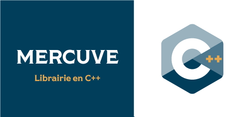
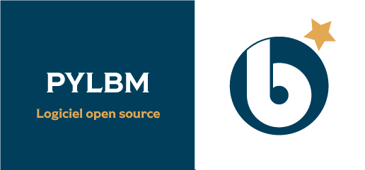

title: josiepy

<section id="code_josiepy" class="page code">
    

    <h1 class="page_title">Librairie josiepy</h1>
    

    

    

        <h2 class="section_title">qu'est-ce que josiepy?</h2>
        
Josiepy est une librairie en Python qui permet de mettre en place des simulations pour des problèmes qui sont gouvernés par des EDP avec simplicité avec la méthode des volumes finis. Tous les aspects d'un problème sont codé directement en Python, en évitant les difficultés que très souvent on rencontre dans des autres codes dans lesquels les configurations se font avec des DSL très limités. 

        <h2 class="section_title text-left">notre approche</h2>
        
 L'idée fondamentale du projet est de fournir une boîte à outils très facile à utiliser pour rapidement tester des idées : développement de schémas, conception de conditions au bord particulières, équations constitutives exotiques, etc... dans des cas 1D, 2D et dans le futur proche 3D. La structure très modulaire de la librairie permet de s'occuper de ces elements constituants un cas à simuler de façon individuelle, en abstrayant le plus possible la façon d'opérer du reste du code. Le code est basé sur l'API de NumPy, qui fournit les structures des données sous-jacentes. 

    

    
 
        

        
 <a href="https://gitlab.com/rubendibattista/josiepy" class="github"> <i class="bi bi-github float-lg-start"></i>
            
 Code 
            https://gitlab.com/rubendibattista/josiepy 

            </a> 

        
 <a href="https://josiepy.rdb.is" class="readdoc"><i class="bi bi-file-text-fill float-lg-start"></i>
            
 Documentation 
            https://josiepy.rdb.is 

            </a> 

        

    

    

    

    

    

        <h2 class="section_title">L'OFFRE ACTUELLE</h2>
        <ul class="list_item">
        <li>Une série de solveurs </li>
        <li>Équations d'Euler</li>
        <li>Équations de Navier-Stokes compressibles</li>
        <li>Équation de la Chaleur</li>
        <li>Équations de Baer-Nunziato pour un système diphasiques</li>
        <li>Schéma d'ordre 2 MUSCL</li>
        <li>Un mailleur simplifié basé sur le transfinite interpolation, codable directement avec l'API Python, qui permet de générer des maillages structurés rapidement et d'intégrer le script de génération du maillage directement dans le code du cas test</li>
        <li>Support pour I/O sur fichiers XDMF</li>
        <li>Sous-système pour génerer des visualisations très rapidement dans le code Python avant d'effectuer des post-processing plus poussés avec des outils externes</li>
        <li>Une installation très facile, qui ne nécessite pas de compiler des modules, et qui est basée sur les conventions de packaging offert par l'ecosystème de Python</li>
        </ul>
    

    

        <h2 class="section_title">NOTRE VISION POUR LE FUTUR</h2>
        
La vision du projet pour le futur est d'offrir un outil très simple à utiliser, depuis Python, sans devoir renoncer à une performance acceptable, avec la possibilité d'exploiter des architectures modèrnes de calcul comme les GPU. Dans ce sens, les points suivants sont envisagés pour le futur

        <ul class="list_item bandeau">
        <li>Amélioration du mailleur intégré pour arriver à offrir la possibilité de générer des maillages structurés par blocs, possiblement avec des générations hyperboliques ou elliptiques</li>
        <li>Puisque le code exploite l'API de NumPy, permettre le calcul sur GPU devient un développement naturel avec la librairie cupy</li>
        <li>Intégration de schémas d'ordre élevé avec la méthode Galerkin Discontinu</li>
        <li>Une interopérabilité avec le code <a href="samurai.html">Samoura&iuml;</a> pour pouvoir traiter aussi des maillages adaptatifs</li>
        </ul>
    

    

</section>
<!-- End Section -->
<!-- ======= Section Autres Codes======= -->
<section id="autresCodes" class="section-bg">

    
Les autres codes proposés

    

    
 

    

    

    

</section>
<!-- End Section Autres Codes-->
