title: Partenaires

<section id="partenaires" class="partenaires">

    <h1 class="page_title">PARTENAIRES ET PROJETS COLLABORATIFS</h1>

<!-- ======= PARTENAIRES ENTREPRISES ======= -->
<section id="portfolio-details-entreprises" class="portfolio-details"  data-aos="fade-up">
    

    

        

        

            <h2 class="section_title text-left">NOS LIENS AVEC dES entreprises de pointe à fort potentiel d'innovation</h2>
            
 <a class="partenaire-link" href="https://www.airliquide.com/fr">AIR LIQUIDE</a> | <a class="partenaire-link" href="https://www.cenaero.be/">CENAERO</a> | <a class="partenaire-link" href="https://about.google">GOOGLE</a> | <a class="partenaire-link" href="https://global.jaxa.jp">JAXA</a> | <a class="partenaire-link" href="https://www.lockheedmartin.com/">LOCKHEED-MARTIN</a> | <a class="partenaire-link" href="https://www.safran-group.com/fr">SAFRAN</a> | <a class="partenaire-link" href="https://www.spacex.com/">SPACEX</a> 

            
 Lorem ipsum dolor sit amet, consectetur adipiscing elit. Nullam nec vestibulum erat. Vivamus molestie metus ut laoreet finibus. Nunc ut ex pellentesque, suscipit tortor ut, aliquam lorem. Ut nunc dolor, pretium ut magna non, mollis cursus nisi.Proin egestas commodo ante vitae.

            
Sed ut perspiciatis unde omnis iste natus error sit voluptatem accusantium doloremque laudantium, totam rem aperiam, eaque ipsa quae ab illo inventore veritatis et quasi architecto beatae vitae dicta sunt explicabo. Nemo enim ipsam voluptatem quia voluptas sit aspernatur aut odit aut fugit, sed quia consequuntur magni dolores eos qui ratione voluptatem sequi nesciunt. 

            

            <i class="bi bi-chevron-compact-down"></i>

        

    

    

        

        

            
 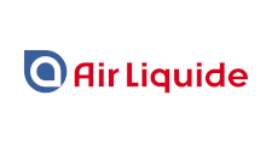
            
Leader mondial des gaz, technologies et services pour l’industrie et la santé

            

            
 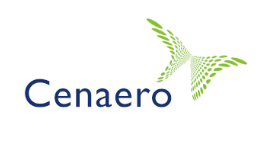
            
Centre de recherche appliquée privé qui fournit des méthodes et des outils de simulation numérique

            

            
 
            
L'une des plus imposantes entreprises du marché d'Internet et l'un des géants du Web

            

            
 
            
 Japan Aerospace Exploration Agency

            

            
 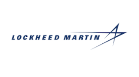
            
Première entreprise américaine et mondiale de défense et de sécurité

            

            
 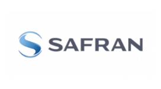
            
Groupe international opérant dans les domaines de l'aéronautique, de l'espace et de la défense

            

            
 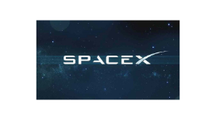
            
Space Exploration Technologies Corporation spécialiste de l'astronautique et du vol spatial

            

        

        

        

    

    

    

    

</section>
<!-- End Portfolio Details Section -->
<!-- ======= PARTENAIRES ORGANISMES ======= -->
<section id="portfolio-details-organismes" class="portfolio-details"  data-aos="fade-up">
    

    

        

        

            

            
 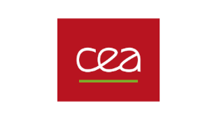
                
Commissariat à l'énergie atomique et aux énergies alternatives

            

            
 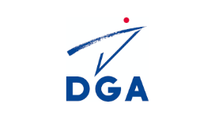
                
Direction Générale de l'Armement

            

            
 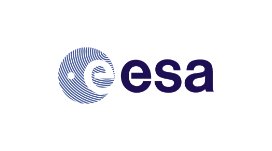
                
European Space Agency

            

            
 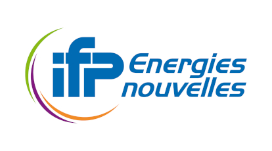
                
IFP énergies nouvelles

            

            
 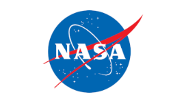
                
National Aeronautics and Space Administration

            

            
 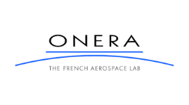
                
Office national d'études et de recherches aérospatiales

            

            

            

        

        

        

        

            <h2 class="section_title">NOS coopérations avec des organes stratégiques de la recherche scientifique</h2>
            
 <a class="partenaire-link" href="https://www.cea.fr/">CEA</a> | <a class="partenaire-link" href="https://www.defense.gouv.fr/dga">DGA</a> | <a class="partenaire-link" href="https://www.esa.int/">ESA</a> | <a class="partenaire-link" href="https://www.ifpenergiesnouvelles.fr">IFPen</a> | <a class="partenaire-link" href="https://www.nasa.gov">NASA</a> | <a class="partenaire-link" href="https://www.onera.fr/fr">ONERA</a>

            
 Lorem ipsum dolor sit amet, consectetur adipiscing elit. Nullam nec vestibulum erat. Vivamus molestie metus ut laoreet finibus. Nunc ut ex pellentesque, suscipit tortor ut, aliquam lorem. Ut nunc dolor, pretium ut magna non, mollis cursus nisi.Proin egestas commodo ante vitae.

            
Sed ut perspiciatis unde omnis iste natus error sit voluptatem accusantium doloremque laudantium, totam rem aperiam, eaque ipsa quae ab illo inventore veritatis et quasi architecto beatae vitae dicta sunt explicabo. Nemo enim ipsam voluptatem quia voluptas sit aspernatur aut odit aut fugit, sed quia consequuntur magni dolores eos qui ratione voluptatem sequi nesciunt. 

            

            <i class="bi bi-chevron-compact-down"></i>

        

    

    

    

    

</section>
<!-- End Portfolio Details Section -->
<!-- ======= PARTENAIRES UNIVERSITES ======= -->
<section id="portfolio-details-universites" class="portfolio-details"  data-aos="fade-up">
    

    

        

        

            <h2 class="section_title text-left">NOS PARTENAIRES UNIVERSITAIRES en france et à l'international</h2>
            
 <a class="partenaire-link" href="https://www.centralesupelec.fr/">CENTRALE SUP&Eacute;LEC</a> | <a class="partenaire-link" href="https://icme.stanford.edu/">ICME</a> | <a class="partenaire-link" href="https://www.inp-toulouse.fr/">INP-TOULOUSE</a> | <a class="partenaire-link" href="http://math.univ-lyon1.fr/">INSTITUT CAMILLE JORDAN</a> | <a class="partenaire-link" href="https://www.math.u-bordeaux.fr">INSTITUT MATHS BORDEAUX</a> | <a class="partenaire-link" href="https://www.imft.fr">INSTITUT DE M&Eacute;CANIQUE DES FLUIDES TOULOUSE</a> | <a class="partenaire-link" href="https://www.iastate.edu/">IOWA STATE UNIVERSITY</a> | <a class="partenaire-link" href="https://www.imo.universite-paris-saclay.fr">MATH&Eacute;MATIQUES ORSAY</a> | <a class="partenaire-link" href="https://www.oden.utexas.edu">ODEN INSTITUTE</a> | <a class="partenaire-link" href="https://www.polimi.it">POLITECHNICO MILANO</a> | <a class="partenaire-link" href="https://www.stanford.edu/">STANFORD</a> | <a class="partenaire-link" href="https://univ-cotedazur.fr/">UNIVERSIT&Eacute; CÔTE D'AZUR</a> | <a class="partenaire-link" href="https://www.utoronto.ca">UNIVERSITY OF TORONTO</a> | <a class="partenaire-link" href="https://www.vki.ac.be">VON KARMAN INSTITUTE</a> 

            
 Lorem ipsum dolor sit amet, consectetur adipiscing elit. Nullam nec vestibulum erat. Vivamus molestie metus ut laoreet finibus. Nunc ut ex pellentesque, suscipit tortor ut, aliquam lorem. Ut nunc dolor, pretium ut magna non, mollis cursus nisi.Proin egestas commodo ante vitae.

            
Sed ut perspiciatis unde omnis iste natus error sit voluptatem accusantium doloremque laudantium, totam rem aperiam, eaque ipsa quae ab illo inventore veritatis et quasi architecto beatae vitae dicta sunt explicabo. Nemo enim ipsam voluptatem quia voluptas sit aspernatur aut odit aut fugit, sed quia consequuntur magni dolores eos qui ratione voluptatem sequi nesciunt. 

            

            <i class="bi bi-chevron-compact-down"></i>

        

    

    

        

        

            
 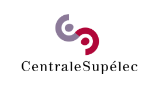
            
Centrale Supélec

            

            
 
            
Institute for Computational & Mathematical Engineering

            

            
 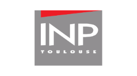
            
Institut national polytechnique de Toulouse

            

            
 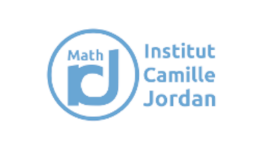
            
Institut Camille Jordan

            

            
 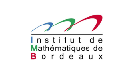
            
Institut de Mathématiques de Bordeaux

            

            
 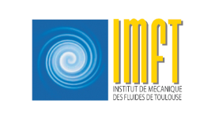
            
Institut de Mécaniques des Fluides de Toulouse

            

            
 
            
Iowa State University

            

            
 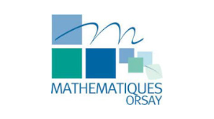
            
Institut de Mathématiques d'Orsay

            

            
 
            
Oden Institute for Computational Engineering & Sciences

            

            
 
            
Politechnico Milano

            

            
 
            
Stanford University

            

            
 
            
Université Côte d'Azur

            

            
 
            
University of Toronto

            

            
 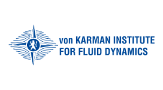
            
Von Karman Institute for Fluid Dynamics

            

        

        

        

    

    

    

    

</section>
<!-- End Portfolio Details Section -->
<!-- ======= PARTENAIRE QUANTSTACK ======= -->
<section id="portfolio-quantstack" class="portfolio-details"  data-aos="fade-up">
    

    

        
 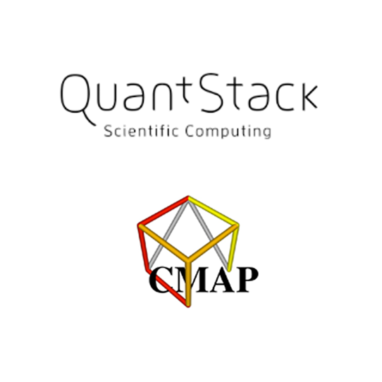 

        

        

            <h2 class="section_title text-left">NOS PROJETS ENTREPRENEURIAUX AVEC LA SOciété QUANTSTACK</h2>
            
 <a class="partenaire-link" href="https://quantstack.net">QUANTSTACK</a> | <a class="partenaire-link" href="https://portail.polytechnique.edu/cmap/fr/page-daccueil">CMAP</a>

            
 L'initiative HPC@Maths et la société QuantStack ont des niveaux d’expertise dans des domaines très variés
            et complémentaires. La collaboration scientifique permet d’enrichir les logiciels open source développés par QuantStack, de mettre à la disposition de la communauté de nouvelles méthodes numériques et de nouveaux algorithmes à la pointe des recherches actuelles, de répondre à des problématiques d’industriels faisant intervenir des mathématiques appliquées. 

            
 <a href="quantstack_cmap.html">
            
En savoir +<i class="point"></i><i class="point"></i><i class="point"></i>

            </a> 

        

        

    

    

</section>
<!-- End Portfolio Details Section -->

</section>
