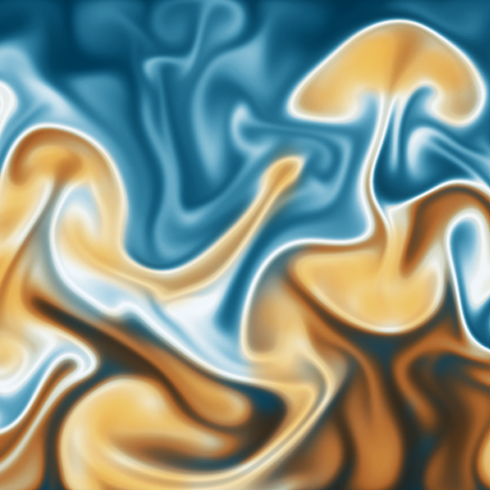
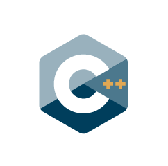

title: pylbm

<section id="code_pylbm" class="page code">
    

    <h1 class="page_title">Logiciel pylbm</h1>
    

    

    

<h2 class="section_title">Un logiciel polyvalent</h2>
        
Pylbm est un logiciel open source écrit en Python. Il propose une implémentation flexible de la méthode Lattice Boltzmann pour les problèmes 1D/2D/3D et a été créé pour s'adresser à diverses communautés:

        <h3 class="subtitle">Pour les mathématiciens</h3>
        
Ce logiciel offre un environnement très agréable pour tester de nouveaux schémas, comprendre leurs propriétés mathématiques, telles que la stabilité et la consistance, et ouvrir à de nouvelles frontières dans le domaine, telles que le raffinement du maillage, les équations équivalentes... 

        <h3 class="subtitle">Pour les physiciens</h3>
        
Pyblm offre un cadre idéal pour mener des expériences numériques pour différents niveaux de modélisation et de schémas, sans avoir à se plonger dans la machinerie mathématique des schémas LBM. Les algorithmes proposés peuvent également permettre d'aller au-delà du premier essai et de réaliser facilement des simulations à grande échelle grâce à sa capacité parallèle.

        <h3 class="subtitle">Pour les informaticiens</h3>
        
 Dans Pylbm, la méthode Lattice Boltzmann n'est pas codée en dur. Des outils avancés de génération de code, basés sur un large ensemble de bibliothèques d'algèbre informatique récemment développées, permettent à l'utilisateur d'entrer à un haut niveau la définition du schéma et les conditions aux limites. Le logiciel pylbm génère ensuite le code numérique résultant. Il est donc possible de modifier les noyaux de construction du code pour tester les performances et l'optimisation du code sur différentes architectures (AA pattern et Pull and Push algorithms); le code peut également être généré dans différents langages (C, C++, openCL, ...)

    

    
 
        

        
 <a href="https://github.com/pylbm/pylbm" class="github"> <i class="bi bi-github float-lg-start"></i>
            
 Code 
            https://github.com/pylbm/pylbm 

            </a> 

        
 <a href="https://pylbm.readthedocs.io" class="readdoc"><i class="bi bi-file-text-fill float-lg-start"></i>
            
 Documentation 
            https://pylbm.readthedocs.io 

            </a> 

        

    

    

    

    

    
  

    

        <h2 class="section_title">Les caractéristiques essentielles</h2>
        
La principale caractéristique de pylbm est sa grande flexibilité en termes de schémas LBM et d'implémentations de code numérique. De plus, il possède d'excellentes capacités parallèles et utilise MPI pour le calcul distribué et openCL pour les GPU.

        
Le cadre généralisé de d'Humières est utilisé pour décrire les schémas. Il est alors facile de définir votre schéma lattice Boltzmann en fournissant les vitesses, les valeurs d'équilibre et les paramètres de relaxation, ... De plus, vous pouvez avoir plusieurs schémas $D_dQ_q$ pour votre simulation où $d$ est la dimension et $q$ le nombre de vitesses. C'est généralement le cas lorsque vous voulez simuler par exemple des écoulements de fluides thermodynamiques comme dans le cas test de Rayleigh-Benard. Mais vous pouvez également expérimenter de nouveaux types de schémas de lattice Boltzmann comme les schémas vectorisés ou avec des vitesses relatives. 

    

    

</section>

<section id="autresCodes" class="section-bg">

    
Les autres codes proposés

    

        <a href="josiepy.html" class="code-thumb row">
            

                <h1>
                    josiepy
                </h1>
                <h2>
                    Méthodes volumes finis en Python
                </h2>
            

            

                
            

        </a>
        <a href="mercurve.html"  class="code-thumb row">
            

                <h1>
                    mercurve
                </h1>
                <h2>
                    Outils de post-traitement
                </h2>
            

            

                
            

        </a>
        <!-- <a href="pylbm.html" class="code-thumb row">
            

                <h1>
                    pylbm
                </h1>
                <h2>
                    Lattice Boltzmann methods
                </h2>
            

            

                
            

        </a> -->
        <a href="samurai.html"  class="code-thumb row">
            

                <h1>
                    samurai
                </h1>
                <h2>
                    Adaptation de maillage
                </h2>
            

            

                
            

        </a>
    

</section>
