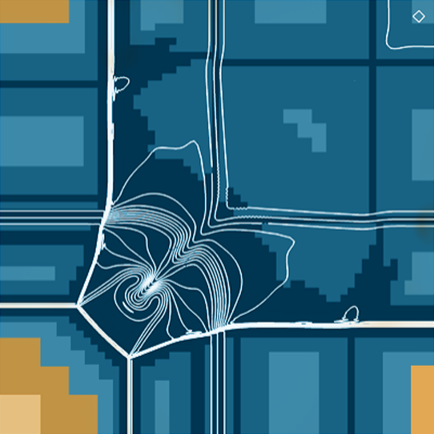

title: samurai

<section id="code_samurai" class="page code">
    

    <h1 class="page_title">Structure de données samurai</h1>
    

    

    

        <h2 class="section_title text-left">Objectif</h2>
        
L'objectif principal de Samurai est de fournir une nouvelle structure de données basée sur les intervalles et l'algèbre d'ensembles pour traiter efficacement les méthodes de raffinement de maillage adaptatif basées sur une grille cartésienne. Une telle approche doit être suffisamment polyvalente pour traiter les méthodes AMR et multi-résolution.

        
 La plupart des structures de données existantes utilisées à cette fin sont basées sur la construction d'un arbre (quadtree en 2d ou octree en 3d). 

        <h2 class="section_title text-left">Avantage</h2>
        
Le principal avantage de l'utilisation d'une structure de données sous forme d'arbre est que l'ajout ou la suppression de noeuds peut être réalisé très rapidement une fois que l'on sait où ils se trouvent ou où les ajouter. Mais la recherche d'un noeud donné dans l'arbre peut prendre beaucoup de temps. Pour améliorer ce temps de recherche, une façon habituelle est d'utiliser une courbe de remplissage de l'espace pour localiser les noeuds de façon linéaire (voir p4est pour un exemple reposant sur la z-curve - Courbe de Lebesgue en français). 

        
Une telle approche peut garantir que le voisinage d'un noeud donné est toujours proche de ce noeud à l'intérieur de la structure de données. Elle est particulièrement importante pour la résolution des EDP utilisant des méthodes numériques telles que les méthodes de volumes finis, d'éléments finis sur le maillage adaptatif.

    

    
 
        

        
 <a href="https://github.com/hpc-maths/samurai" class="github"> <i class="bi bi-github float-lg-start"></i>
            
 Code 
            https://github.com/hpc-maths/samurai 

            </a> 

        
 <a href="https://hpc-math-samurai.readthedocs.io" class="readdoc"><i class="bi bi-file-text-fill float-lg-start"></i>
            
 Documentation 
            https://hpc-math-samurai.readthedocs.io 

            </a> 

        

    

    

    

    

            
  

    

        <h2 class="section_title text-left">Notre approche</h2>
        
Un opérateur discret faisant intervenir un stencil doit évaluer diverses cellules de voisinage ou potentiellement les reconstruire pour la structure d'arbre, et cela doit être fait rapidement. Afin d'améliorer l'efficacité de l'arbre / remplissage de l'espace, la nouvelle structure de données proposée s'appuie sur la représentation du maillage sous forme d'intervalles à différents niveaux de résolution. La plupart des opérations sur le maillage sont effectuées par des opérations utilisant une algèbre d'ensembles. L'approche vise à combiner trois objectifs: 

        <ul class="list_item">
        <li>Améliorer l'efficacité de la manipulation du maillage par rapport à la combinaison construction d'un arbre / courbes de remplissage d'espace </li>
        <li>Découpler l'évolution du maillage des méthodes numériques utilisées pour résoudre les EDP et rendre particulièrement intuitive l'implémentation d'un nouveau schéma</li>
        <li>Introduire une approche qui aura de bonnes propriétés pour le calcul parallèle distribué. </li>
        </ul>
    

    

</section>

<section id="autresCodes" class="section-bg">

    
Les autres codes proposés

    

        <a href="josiepy.html" class="code-thumb row">
            

                <h1>
                    josiepy
                </h1>
                <h2>
                    Méthodes volumes finis en Python
                </h2>
            

            

                
            

        </a>
        <a href="mercurve.html"  class="code-thumb row">
            

                <h1>
                    mercurve
                </h1>
                <h2>
                    Outils de post-traitement
                </h2>
            

            

                
            

        </a>
        <a href="pylbm.html" class="code-thumb row">
            

                <h1>
                    pylbm
                </h1>
                <h2>
                    Lattice Boltzmann methods
                </h2>
            

            

                
            

        </a>
        <!-- <a href="samurai.html"  class="code-thumb row">
            

                <h1>
                    samurai
                </h1>
                <h2>
                    Adaptation de maillage
                </h2>
            

            

                
            

        </a> -->
    

</section>
